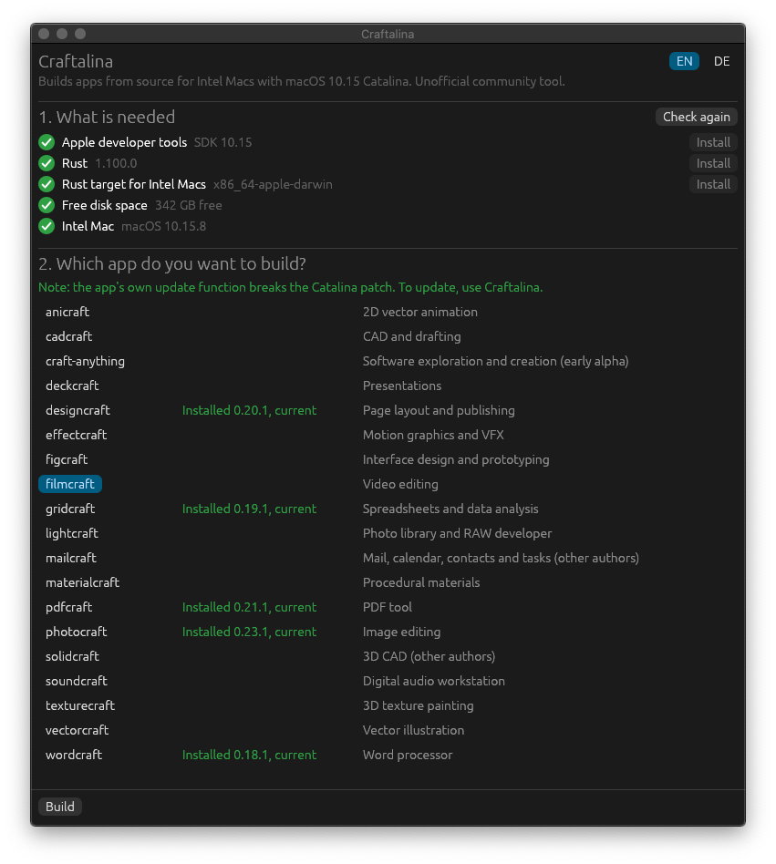

# Craft apps for macOS 10.15 Catalina (unofficial)

Unofficial community project that builds the Craft apps from
[storytold](https://github.com/storytold) for **macOS 10.15 Catalina on Intel Macs**. It is not
affiliated with or endorsed by the original authors. The apps are made by the ArtCraft team and
their contributors and are licensed under MIT OR Apache-2.0.

This repository contains **no source code of the apps and no logos**, only `install.sh` (builds one
app on your Mac), `app/` (the source of **Craftalina**, a small window around `install.sh`), a
GitHub workflow (builds one app on GitHub), small patches in `patches/`, and this README. Builds are **Intel (x86_64) only**, **ad-hoc signed and not notarized**. Apple silicon Macs
do not need this project.

## Install

You need macOS 10.15 on an Intel Mac, an internet connection and several GB of free disk space.
The first build of an app takes a long time (30 minutes or more); one app is built at a time.

### Option 1: Craftalina (recommended, no Terminal)

Craftalina is an unofficial small window around `install.sh`. It contains **only the window, no Craft
app**.



1. Download the newest `Craftalina-<version>-macos10.15-x86_64.zip` from the
   [Releases page](https://github.com/sudo-mk-sandwich/craft-catalina/releases), unzip it and drag
   **Craftalina** into your Applications folder.
2. Open it the first time with **right-click > Open**. If macOS still blocks it: System Preferences >
   Security & Privacy > General > Open Anyway (the app is not notarized by Apple).
3. The window checks what is needed (developer tools, Rust) and installs missing parts on a click.
   Pick an app, press **Build**, wait. At the end it offers to copy the app to your Applications
   folder (replacing an older version) and to keep or delete the sources.

At every start Craftalina downloads the newest `install.sh` and patches from this repository
(internet needed; without it the copy from the last start is used), so you do not need a new
Craftalina when a patch changes. English and German.

### Option 2: Terminal (manual)

Type this into the **Terminal** app (Applications > Utilities > Terminal):

```
git clone https://github.com/sudo-mk-sandwich/craft-catalina.git
cd craft-catalina
bash install.sh
```

If macOS offers to install the developer tools when you type `git`, accept, wait until it is
finished, and type the commands again.

Choose the app in the menu (**arrow keys**, **Enter** to start, `q` to quit). The script installs
missing tools (it asks before installing Rust), builds the latest stable release with the
Catalina changes, stops at the first error, and finally opens the folder with the finished app.
Drag the app into your Applications folder and open it the first time with **right-click > Open**.

Variants:

```
bash install.sh wordcraft                        # skip the menu
CRAFT_REF=v0.5.0 bash install.sh wordcraft       # a specific tag or branch
CRAFT_BUILD_DIR=/Volumes/Big/craft bash install.sh   # build somewhere else
CRAFT_NO_UPDATE=1 bash install.sh                # skip the git pull (offline)
```

## Update

The apps' own automatic in-app updates do **not** work with these builds. Update with this project
instead:

- **Craftalina:** apps in your Applications folder are marked with their version. Craftalina compares
  it with the newest stable version on GitHub and shows **Update: 0.18.1 -> 0.19.0** when there is a
  newer one (the button then says Update). The check needs internet and is skipped quietly without it.
- **Terminal:** the three commands above are needed only once; afterwards
  `cd craft-catalina` and `bash install.sh` is enough (`cd` is relative to the folder where you ran
  `git clone`, usually your home folder). The script first pulls new patches and script fixes
  (`git pull`), then builds the latest release of the app you choose.

Developers can also start Craftalina from the source (needs Rust, see "Build by hand" below):
`cd app && cargo run --release`.

## What is changed

1. **Minimum macOS version lowered from 11.0 to 10.15** in `packaging/macos/package.sh` and
   `packaging/macos/Info.plist.in`.
2. **App-specific patches** in `patches/` where an app needs more (see the table). They apply to
   every new version; if an upstream change breaks one, the build stops with a clear message.

## Status

Initially tested in November 2026 with the then-current releases (for example PhotoCraft 0.23.1).
Newer versions are built the same way, but only the first tested version is known to work.
"Basic tests" means: the app starts, and documents can be opened and saved. Other functions are
**not** tested, and a function from a newer macOS can still crash an app when it is used. Please
report test results as an issue.

| App | Patch | Tested on Catalina |
|---|---|---|
| AniCraft | linker setting `patches/anicraft.cargo-config.toml` (system-audio capture needs macOS 14.2+; looked up only when used) | basic tests; the in-app menu bar is only visible in full-screen mode (may also happen upstream) |
| CADCraft | none | basic tests; double-click issue (see below) |
| Craft Anything | `patches/craft-anything.*`: placeholder for the missing framework AVFAudio and a replacement for `CGPreflightScreenCaptureAccess` (see below) | builds and starts; **experimental**. Functions not tested (it needs a connected AI agent) |
| DeckCraft | none | basic tests |
| DesignCraft | none | basic tests |
| EffectCraft | none | basic tests |
| FigCraft | none | basic tests |
| FilmCraft | none | basic tests |
| GridCraft | none | basic tests |
| LightCraft | none | basic tests; the first start hung once and worked after quitting the app and starting it again |
| MailCraft | none (built from UCS-Care-Group/mailcraft; see note below) | starts and runs; no mail account set up, mail functions not tested |
| MaterialCraft | none | basic tests; double-click issue (see below) |
| PdfCraft | none | basic tests |
| PhotoCraft | `patches/photocraft.patch` and linker setting: the screen color picker called two system functions from macOS 11 and crashed on 10.15; the patch skips them there | basic tests, screen color picker |
| SolidCraft | none (built from tangency-labs/solidcraft; see note below) | basic tests |
| SoundCraft | linker setting `patches/soundcraft.cargo-config.toml` (same as AniCraft: system-audio capture needs macOS 14.2+) | basic tests, recording works; system-audio recording is not available; double-click issue (see below) |
| TextureCraft | none | basic tests; double-click issue (see below) |
| VectorCraft | none | basic tests |
| WordCraft | none | basic tests |

**Double-clicking files in Finder:** in SoundCraft, CADCraft, TextureCraft and MaterialCraft the app
starts but shows "The document ... could not be opened. ... cannot open files in the ... format".
Opening the same file with **File > Open** inside the app works. This is probably a bug of the
apps themselves (the apps are still in alpha), not of the Catalina build; it has not been compared
with a newer macOS.

**Craft Anything is experimental on Catalina.** It is a tool that inspects and controls other
apps and uses system functions that do not exist on macOS 10.15. To make it build, the script adds a
placeholder for the missing framework `AVFAudio` and a small replacement for
`CGPreflightScreenCaptureAccess` (screen recording permission check, macOS 11+; on Catalina it
answers "allowed"). Functions that need newer system features may be missing or may fail in ways
that are hard to predict.

**MailCraft and SolidCraft** belong to the Craft family but are not made by the storytold account:
MailCraft comes from [UCS-Care-Group/mailcraft](https://github.com/UCS-Care-Group/mailcraft),
SolidCraft from [tangency-labs/solidcraft](https://github.com/tangency-labs/solidcraft). The script
builds them the same way. A source build of MailCraft has no Google sign-in (the project injects that
registration only into its own releases); other account types are not affected by this.
SolidCraft's brand, look and name are licensed separately (`LICENSE-BRAND`): building it for
yourself is allowed, but distributing a build under the SolidCraft name needs the maintainers'
written permission. So please build SolidCraft **on your own Mac or in your own fork** and do not
pass the result on.

## Build on GitHub (no Mac needed)

1. Fork this repository.
2. In the **Actions** tab, enable workflows, choose **Catalina builds (manual)** and **Run
   workflow**.
3. Pick the app. Leave "ref" empty for the latest stable release.
4. The `.dmg` is attached to the run as an artifact (kept for 3 days).

The GitHub runner has a newer macOS SDK than a Catalina Mac. The build shows that an app compiles,
not that it runs on Catalina; test the result on a real Catalina Mac.

## Troubleshooting


**The app builds but does not start in a virtual machine** with "No suitable graphics adapter found": the Craft apps draw with Metal, and most virtual machines (VirtualBox, VMware, Parallels on old macOS guests) offer no Metal graphics. Run them on a real Mac.

- **The pull fails:** you created or changed a file in this folder by hand that now exists in this
  repository. Delete your copy (`rm patches/<file>`) or undo the change
  (`git checkout -- <file>`) and run the script again.
- **`Undefined symbols ...` while linking:** the app calls a system function Catalina does not
  have. That needs a patch for this app; please open an issue with the last 30 lines of the output.
- **The app is built, but "creating the disk image" fails** (for example SolidCraft: `Could not find
  a version that satisfies the requirement dmgbuild`): the disk image needs a newer Python than
  Catalina has. The script treats this as success: the app is in the folder that opens, the disk
  image is not needed.
- **`ld: framework not found ...`:** the app links a framework that Catalina does not have. Please
  open an issue (Craft Anything solves this with a placeholder, see `patches/`).
- **`patches/<app>.patch does not apply`:** the app changed the code the patch touches. Please open
  an issue; build an older release meanwhile with `CRAFT_REF=<tag>`.
- **`MACOSX_DEPLOYMENT_TARGET is not 10.15 ... after the change`:** upstream changed the lines the
  script edits. Please open an issue.
- **An app has no release yet:** name a branch, for example `CRAFT_REF=main bash install.sh <app>`.
- **The app crashes when a certain function is used:** start it from the Terminal to see the
  message, for example `/Applications/WordCraft.app/Contents/MacOS/WordCraft`, and open an issue
  with the output.

## Build by hand (alternative to the script)

For people who want to see every step. Replace `wordcraft` with the app you want.

```
xcode-select --install
curl --proto '=https' --tlsv1.2 -sSf https://sh.rustup.rs | sh
```

Press Enter for the default installation, **open a new Terminal window**, then:

```
rustup target add x86_64-apple-darwin
mkdir -p ~/craft-build && cd ~/craft-build
git clone https://github.com/storytold/craft-i18n.git
git clone https://github.com/storytold/wordcraft.git
git clone https://github.com/sudo-mk-sandwich/craft-catalina.git
cd wordcraft
git checkout "$(git tag --list 'v[0-9]*' --sort=-v:refname | grep -v -- '-' | head -n 1)"
perl -pi -e 's/MACOSX_DEPLOYMENT_TARGET=11\.0/MACOSX_DEPLOYMENT_TARGET=10.15/' packaging/macos/package.sh
perl -0pi -e 's|(LSMinimumSystemVersion</key>\s*<string>)11\.0|${1}10.15|' packaging/macos/Info.plist.in
git apply ../craft-catalina/patches/wordcraft.patch
CRAFT_I18N_DIR="$PWD/../craft-i18n" bash ./packaging/macos/package.sh --arch x86_64
open target/macos-package
```

Leave out the `git apply` line if there is no patch for the app. If `patches/<app>.cargo-config.toml`
exists, copy it to `.cargo/config.toml` first (`mkdir -p .cargo`). Some apps need `resvg` for the
disk image: if the build asks for it, run the `cargo install resvg ...` command it prints.

## License

The code that gets built is under MIT OR Apache-2.0; see the original repositories for
`LICENSE-MIT`, `LICENSE-APACHE` and `NOTICE`. Those files are also bundled in the apps. This
repository's own files (script, workflow, patches, README) are provided as is, without warranty.
